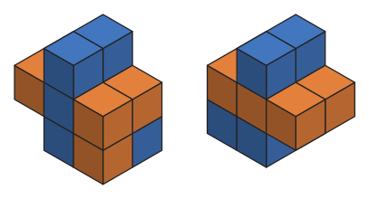

# Polycubes that lock with a rotated copy of themselves

The number of free polycubes with n cells that can be locked together with a rotated copy of
themselves, so that neither copy can be slid off the other along any coordinate axis. This is OEIS
[A399616](https://oeis.org/A399616).



One of the two smallest examples, seen from two opposite sides. Blue is the polycube and orange is
the same shape after a half turn. Each piece is a C of five cubes with one more cube attached, and
the gap in each C is filled by a cube of the other piece.

Nothing with fewer than 6 cells locks, and at 6 cells only two polycubes do. After that it grows
fast. At n = 12, for the first time, more than half of all free polycubes lock (5085614 of
9371094), and by n = 14 it is about 70%.

Locked along the axes is not the same as stuck, though. Some locked pairs still come apart if the
copy slides diagonally. There is an example further down.

## The sequence

a(n) for n = 1, 2, 3, ...

```
0, 0, 0, 0, 0, 2, 45, 569, 6262, 61836, 573662, 5085614, 43643977, 365613720
```

The total number of free polycubes is OEIS [A038119](https://oeis.org/A038119).

## Definition

Take a polycube P, rotate a copy of it and place the copy Q next to it so that the two share at
least one face but no cell. Q is blocked in a direction (one of +x, -x, +y, -y, +z, -z) if moving it
some whole number of steps that way makes it overlap P. If Q is blocked in all six directions, the
pair is locked: neither piece can be slid off the other along an axis. The rotation is allowed to be
the identity, so a plain translated copy counts too.

Whether a polycube locks does not depend on its handedness: reflecting a locked pair through a
coordinate plane turns the rotation into another rotation and permutes the six axis directions, so
the mirror image locks too. That is why the count is taken over free polycubes, as in A038119.

Allowing the copy to be reflected as well as rotated first makes a difference at n = 8 (571 instead
of 569). Allowing only a translated copy, with no rotation, first works at n = 9, for 5 polycubes.
Both are in `terms.txt`.

## The smallest examples

The two 6-cell polycubes that lock are

```
(0,0,0) (0,0,1) (0,0,2) (0,1,0) (0,1,2) (1,1,0)
(0,0,0) (0,0,1) (0,0,2) (0,1,0) (1,0,2) (1,1,0)
```

and each has exactly one locked placement, with the same half turn R: (x,y,z) -> (-z,-y,-x) and
offset (1,1,1). The first one is the one in the picture, and its copy is (-1,0,1) (-1,1,1) (0,1,1)
(1,0,0) (1,0,1) (1,1,1). That pair is only two cubes deep in y, so it fits in two layers. Here P is
the polycube, Q is the copy, x runs from -1 to 1 left to right and z from 2 at the top to 0:

```
y = 0      y = 1
. P .      . P .
Q P Q      Q Q Q
. P Q      . P P
```

All six moves of Q can be checked on these two grids. The two C's stop five of them. The sixth, +y,
is stopped only where the two extra cubes meet: Q's cube at (1,0,0) would land on P's at (1,1,0).

## What "locked" does and does not mean

Blocked along the six axis directions is weaker than "cannot be separated at all". The 7-cell
polycube (0,0,0) (0,0,1) (0,0,2) (0,0,3) (0,1,0) (1,0,3) (1,1,0) has one locked placement, with the
same R and offset as above. With x from -2 to 1 and z from 3 down to 0:

```
y = 0        y = 1
. . P P      . . . .
. . P .      . . . .
. . P Q      Q Q Q Q
. . P Q      Q . P P
```

Q is blocked along every axis, but it slides out along the diagonal (1,0,1), up and to the right in
both layers, without ever overlapping P. Of the 45 polycubes with 7 cells that lock, 42 have a
placement from which no sequence of translations separates the two copies.

Also, locking is not passed on to bigger polycubes. The first 6-cell polycube above locks, but
adding the single cell (-1,0,1) gives a 7-cell polycube that does not, with a rotated or a reflected
copy.

## Files

- `a_redelmeier/twin.c` enumerates fixed polycubes with Redelmeier's algorithm and keeps one per
  free class. For each one and each rotation it builds the set D of differences between the cells
  of P and of the rotated copy; a placement overlaps exactly when its offset is in D, so the whole
  test runs on D. Build with `gcc -O3 -march=native -o twin.exe twin.c` (Windows, MinGW).
  `twin count N` does one n in a single process; `twin selftest ../data/selftest_lines.txt` checks
  n = 1 to 10.
- `a_redelmeier/driver.py` splits one n into shards and runs them on several cores, and can be
  stopped and restarted: `python driver.py N D W OUTDIR` with shard depth D and W workers.
- `b_canonical/src/main.rs` is the second program, written separately, in Rust. It generates each
  free polycube from one canonical parent, in McKay's sense, so the free classes form a tree and a
  depth-first walk over that tree reaches every polycube exactly once while holding only the path
  from a single cell to the current shape. One pass gives every n up to nmax. `b_canonical/src/dr.rs`
  holds its locking test, on the same difference set D: the candidate offsets are generated as the
  neighbours of D, membership is one bit test, and blocking along a direction is one comparison
  against a minimum and a maximum kept per line of D. Build with `cargo build --release`.
  `twin_b5 selftest 10` prints the lines for n = 1 to 10, which should equal
  `data/selftest_lines.txt`.
- `b_canonical/driver.py` runs one n in shards, a shard being the subtree of that walk rooted at one
  free class of size d. `twin_b5 shardtable D TABLE` writes the table, then
  `python driver.py EXE TABLE N WUPTO OUTDIR [workers]` runs it. It can be stopped and restarted.
- `reference/lock_small.py` is a short, slow program that checks the definition directly, cell by
  cell, using the standard library only. It is meant for reading and for small n.
- `figure/lock6.py` draws `figure/lock6.svg` from the cells listed above, after checking what this
  page says about that pair. Standard library only; run it from the `figure` folder.
- `terms.txt` lists n, A038119(n), a(n), the count with reflections allowed, and the count with
  translation only, for n = 1 to 14.
- `checksums.txt` lists, for each n, the count and two 64-bit checksums of three sets: all free
  polycubes, the ones that lock with a rotated copy, and the ones that lock with a rotated or
  reflected copy.
- `data/selftest_lines.txt` is the same table for n = 1 to 10, which `twin.c` checks itself against
  before every run and which `twin_b5 selftest 10` should reproduce.

## Checksums

Two programs can agree on a count and still have counted different shapes. The checksums catch
that. For each polycube, take its 48 images under the symmetries of the cube, move each one so that
its smallest x, y and z are 0, and sort its cells. The smallest of the 48 sorted lists is REF(P).
Then, with all arithmetic mod 2^64,

```
splitmix64(x):
    x = x + 0x9E3779B97F4A7C15
    x = (x ^ (x >> 30)) * 0xBF58476D1CE4E5B9
    x = (x ^ (x >> 27)) * 0x94D049BB133111EB
    return x ^ (x >> 31)

H(P, seed):
    h = seed
    for (x, y, z) in REF(P):
        h = splitmix64(h ^ (x | (y << 8) | (z << 16)))
    return splitmix64(h ^ n)
```

with seeds 0x243F6A8885A308D3 and 0x13198A2E03707344. A checksum in `checksums.txt` is the sum of
H over every polycube in the set.

## Checks

- At every n both programs find exactly A038119(n) free polycubes, and their fixed and achiral
  counts match [A001931](https://oeis.org/A001931) and [A007743](https://oeis.org/A007743), so no
  shape is missed or counted twice.
- For n = 1 to 14 the two programs agree on all three counts and on all six checksums, so they
  found the same sets of polycubes, not just the same number of them.
- For n = 1 to 11 a third program, which tests every placement cell by cell, gives the same results.
  This one matters for a specific reason: both main programs reduce the locking test to the
  difference set D, so an error in that reduction would be shared by them and their agreement would
  not show it. The third program places the copy and checks it in cell space instead.
- At n = 13 and 14 both programs wrote out every polycube whose second checksum is 0 mod 65536, a
  sample of about 1 in 65536 chosen by the shape itself. The samples were the same 1028 and 7954
  shapes, and each one was decided again by the third program.

## References

- S. Dhawan and Z. Abel, Complexity of Interlocking Polyominoes, arXiv:1112.4087 [math.CO], 2011.
  [arXiv:1112.4087](https://arxiv.org/abs/1112.4087)

## License

MIT
